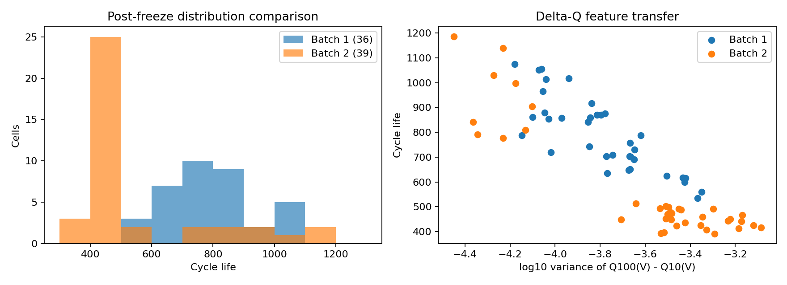
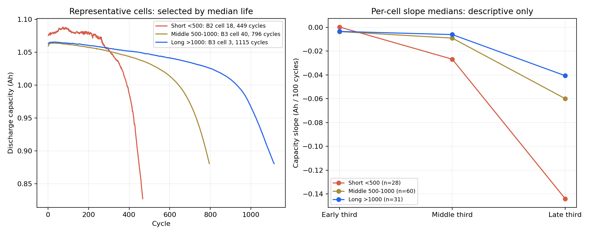
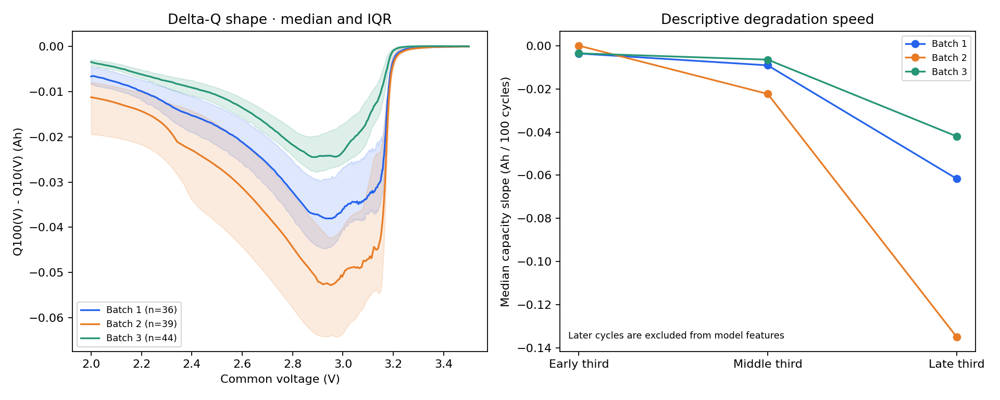
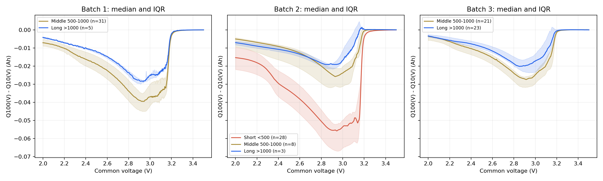
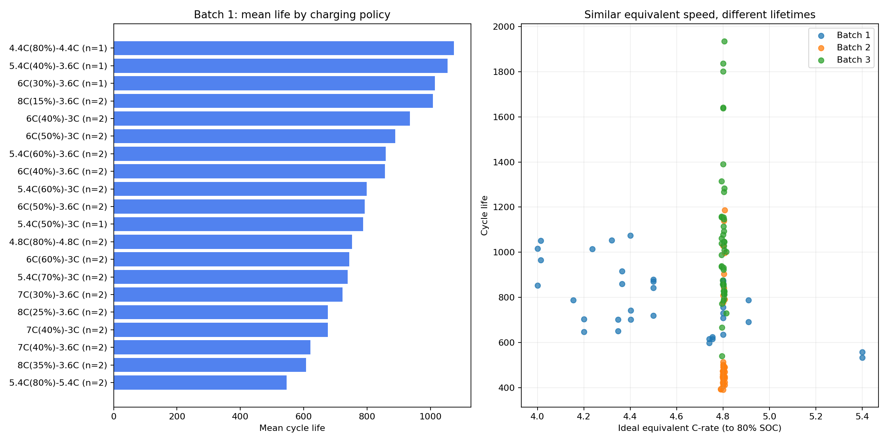
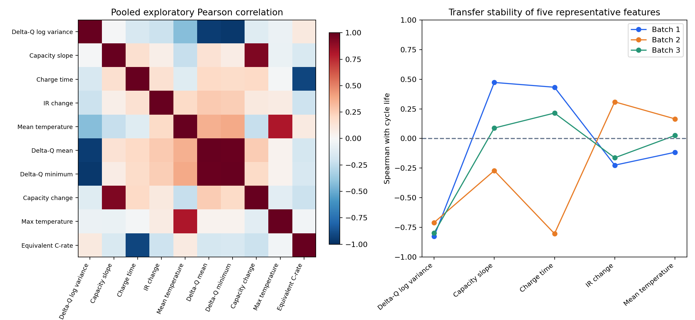
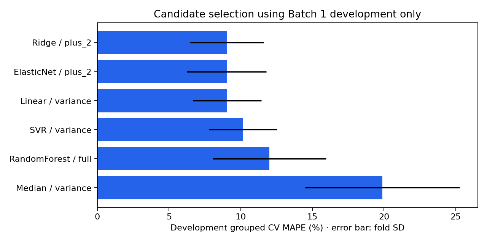
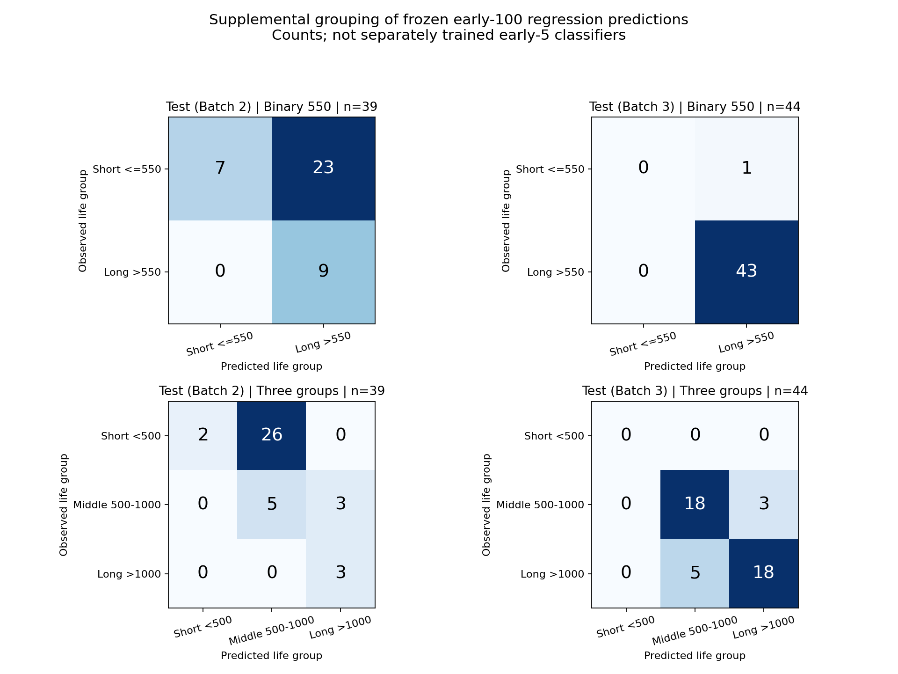
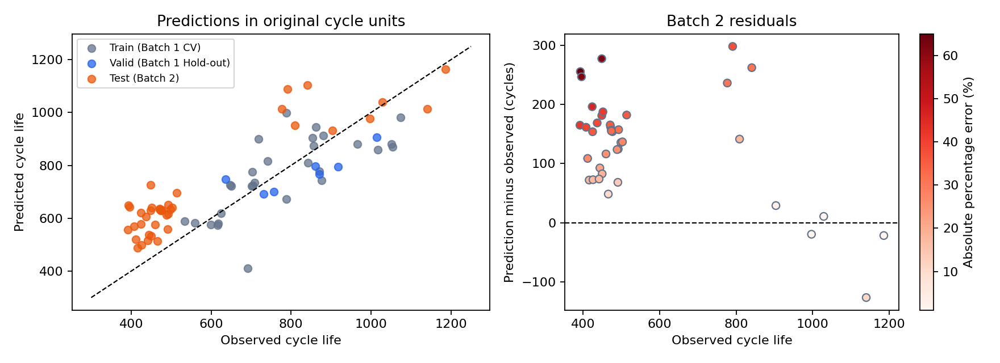

# ESS 배터리 수명 예측

초기 100사이클에서 **계획서의 피처 후보를 계산·선택한 회귀 모델**로 총 Cycle Life를 예측합니다. 같은 예측 수명을 2구간·3구간으로 나누어 결과를 각각 평가하고 논문 보고값과 비교합니다. 논문은 성능 비교의 기준으로 사용합니다.

## 프로젝트 개요

- 주 태스크: Regression — log10(cycle_life) 학습 후 사이클 단위 복원
- 데이터: MIT–Stanford Battery Dataset 계열; 학습 Batch 1 (2017-05-12), 필수 평가 Batch 2 (2018-02-20), 추가 평가 Batch 3 (2018-04-12)
- 학습 36셀: 개발 29셀·16정책 / Hold-out 7셀·4정책
- 최종 모델: **Ridge, alpha=0.1**; 선택 피처 **ΔQ log 분산 + 초기 충전 시간**
- 추가 평가: 같은 회귀 예측의 2구간(550회)·3구간(500·1,000회) 구간화. 별도 분류기 학습 결과와 구분합니다.
- [DAY 1 계획서](DAY1/DS-MINI-Design-울산_3반-최유정.pdf) · [실행 결과와 직접 재현 노트북](DAY2/03_modeling.ipynb)

### 핵심 결과 — 구간화 전 회귀

| 평가 | 셀 수 | MAPE (%) | MAE (회) | RMSE (회) |
| --- | --- | --- | --- | --- |
| Train (Batch 1 CV) | 29 | 10.842 | 86.504 | 102.695 |
| Valid (Batch 1 Hold-out) | 7 | 10.435 | 85.643 | 90.719 |
| Test (Batch 2) | 39 | 28.609 | 141.752 | 158.676 |
| Test (Batch 3) | 44 | 12.156 | 147.910 | 232.046 |

Batch 2 MAPE는 **28.609%**, 과제 Target 9.1%와의 차이는 **+19.509%p**입니다. 단수명 범위에서 과대예측이 반복됐으며, 구간화 후의 점수도 아래에서 별도로 보고합니다.

## 파일 구조

```text
├── archive/                 # 원본 MAT; Git 제외
├── data/README.md           # 데이터·라벨·제외 기준
├── DAY1/                    # 모델 전략 보고서
├── DAY2/03_modeling.ipynb
├── DAY2/results/            # 피처·CV·예측·지표·그림·검증 근거
├── src/
│   ├── preprocess.py / features.py / train.py
│   ├── diagnostics.py / eda_reporting.py
│   ├── paper_comparison.py  # 저장된 회귀 예측 구간화·논문 수치 비교
│   ├── label_audit.py       # Batch 2 라벨 검증
│   ├── report.py / plan_report.py
│   └── verify_results.py / verify_plan_results.py
└── requirements.txt
```

## 환경 설정

Python 3.11, scikit-learn 1.6.1 기준입니다. 원본 MAT는 [데이터 안내](data/README.md)에 따라 archive/에 둡니다.

```bash
git clone https://github.com/chyj1022/DS-MINI-Develop-U104.git
cd DS-MINI-Develop-U104
python3 -m venv .venv
source .venv/bin/activate
pip install -r requirements.txt
python -m src.train --batch3
python -m src.verify_results
```

필수 Batch 1·2만 재학습하려면 `--batch3`를 생략합니다. DAY 1의 세 배치 EDA는 [계획서](DAY1/DS-MINI-Design-울산_3반-최유정.pdf)와 [기존 노트북](30-ESSHealth-scratch.ipynb)에서 확인합니다. 저장된 결과로 문서·구간화 표만 갱신하려면 `python -m src.report`, 라벨 재검사는 `python -m src.label_audit --archive-dir archive`입니다. 원본 MAT와 모델 joblib는 Git 제외이며, 재학습하면 모델이 생성됩니다. 원본 해시·크기·환경은 `provenance.json`에 기록합니다.

### 타깃과 데이터 품질

논문의 총 Cycle Life는 명목 1.1Ah의 80%, **0.88Ah** 도달까지의 사이클 수입니다. 현재 학습 라벨은 MAT에 저장된 cycle_life입니다. Batch 1의 후속 측정 5셀과 조기 종료 5셀을 제외해 36셀, Batch 2는 결측 라벨 8셀을 제외해 39셀을 사용합니다. 학습 수명 범위는 534–1,074회이며, 장수명 후속 기록 제외로 범위가 좁아진 조건을 고려합니다. [제외 내역](DAY2/results/cell_audit_all.csv)

Batch 2 유효 39셀은 원본 summary.cycle의 최초 Qd≤0.88Ah 도달 사이클과 저장 라벨을 대조했습니다. **정확 일치 39셀 / 불일치 0셀 / 미도달 0셀**입니다. [셀별 검사](DAY2/results/batch2_cycle_life_audit.csv). 입력 관측 창은 100회까지이며 전체 수명 종료 용량·knee·기록 길이는 설명용으로만 사용합니다.

## EDA

DAY 1과 같은 **단수명 <500회 / 중간 500–1,000회 / 장수명 >1,000회** 기준을 유지합니다. 분모는 모델링에 사용할 유효 라벨 셀이며 알려진 불완전·결측 라벨은 제외했습니다. 그룹이 없는 배치는 0셀로 표시하고 경계를 바꾸어 채우지 않습니다. 이 기준은 아래 EDA·회귀 오류 분석과 예측 수명의 3구간 평가에 사용합니다. 회귀 입력에는 실제 수명 그룹을 넣지 않습니다. 원논문의 장·단수명 이진 기준(550회)은 구간화 후 비교 절에서 별도로 분석합니다.

### 1. Cycle Life 분포

수명 통계의 단위는 사이클 수입니다.

| Batch | 유효 셀 수 | 최소 | 중앙값 | 평균 | 표준편차 | 최대 |
| --- | --- | --- | --- | --- | --- | --- |
| 1 | 36 | 534.000 | 772.500 | 788.417 | 148.696 | 1074.000 |
| 2 | 39 | 392.000 | 472.000 | 565.744 | 222.202 | 1186.000 |
| 3 | 44 | 541.000 | 1005.500 | 1059.659 | 313.870 | 1935.000 |

| Batch | 분모 (셀) | 단수명 <500 | 중간 500–1,000 | 장수명 >1,000 |
| --- | --- | --- | --- | --- |
| 1 | 36 | 0셀 (0.0%) | 31셀 (86.1%) | 5셀 (13.9%) |
| 2 | 39 | 28셀 (71.8%) | 8셀 (20.5%) | 3셀 (7.7%) |
| 3 | 44 | 0셀 (0.0%) | 21셀 (47.7%) | 23셀 (52.3%) |



Batch 1은 중간 수명에 집중되고 <500회 셀이 없습니다. Batch 2는 28/39셀(71.8%)이 <500회이고 소수의 긴 수명 셀 때문에 오른쪽 꼬리가 나타납니다. Batch 3은 더 넓은 범위로 분포하며 장수명 비중이 큽니다. 위 Batch 2 그래프는 고정 모델 평가 후의 사후 진단으로 후보 선택에 사용하지 않았습니다.

**핵심 발견:** 학습 배치에 없는 단수명 구간이 외부 Batch 2의 대부분을 차지하므로 단수명 개발 데이터 확보와 배치 간 일반화 검증이 중요합니다.

### 2. 열화 곡선 분석



왼쪽은 수명순으로 정렬한 각 그룹의 아래쪽 중앙 셀을 선택한 실제 곡선입니다. 곡선 모양을 보고 대표 셀을 고르지 않았습니다. 단수명 <500: Batch 2 셀 18, 449회 / 중간 500–1,000: Batch 3 셀 40, 796회 / 장수명 >1,000: Batch 3 셀 3, 1115회. 오른쪽과 아래 표는 셀별 관측 기간을 3등분한 기울기의 그룹 중앙값으로 **Ah/100사이클** 단위입니다. 대표 셀 곡선과 전체 그룹 요약은 구분합니다.

| 수명 그룹 | 셀 수 | 초기 기울기 | 중기 기울기 | 말기 기울기 |
| --- | --- | --- | --- | --- |
| 단수명 <500 | 28 | 0.000 | -0.027 | -0.144 |
| 중간 500–1,000 | 60 | -0.004 | -0.009 | -0.060 |
| 장수명 >1,000 | 31 | -0.003 | -0.006 | -0.041 |

단수명 말기 감소 속도의 절댓값은 장수명의 약 **3.54배**입니다. 통합 그룹 비교에서 관측된 차이이며 단수명 28셀이 모두 Batch 2여서 수명·배치 효과를 분리할 수 없습니다. 초기·중기·말기는 같은 절대 사이클 구간이 아니라 각 셀의 기록 진행률 구간입니다.

#### Knee point 존재 여부와 시점

100회 이후 용량에 연속 구간선형 모델을 적합하고 관측 기간의 20–80% 범위에서 knee 후보를 탐색했습니다. 후반 기울기가 음수이고 이전보다 감소가 빠르며 크기가 2배 이상인 경우를 형태 조건으로 표시했습니다. 총 119셀 중 118셀이 조건을 충족했지만 **33셀은 탐색 경계**에 걸렸습니다. 아래 시점은 경계에 걸리지 않고 형태 조건을 충족한 후보만의 요약입니다.

| 수명 그룹 | 셀 수 | 탐색 경계 후보 | 내부·형태 조건 충족 | 후보 범위 (회) | 후보 중앙값 (회) | 수명 대비 시점 중앙값 |
| --- | --- | --- | --- | --- | --- | --- |
| 단수명 <500 | 28 | 4 | 24 | 313.2–406.2 | 363.285 | 80.7% |
| 중간 500–1,000 | 60 | 17 | 42 | 387.5–783.1 | 614.363 | 76.5% |
| 장수명 >1,000 | 31 | 12 | 19 | 759.3–1532.9 | 907.719 | 78.5% |

**핵심 발견:** 장·단수명 모두 후반 열화 가속이 관측되며 단수명 그룹의 말기 감소가 더 가파릅니다. Knee 후보 시점은 셀마다 달라지고 경계 후보가 있어 정확한 열화 시작점의 확정으로 해석하지 않습니다. 전체 곡선·말기 기울기·knee는 미래 관측 설명용으로 모델 입력에서 제외합니다.

### 3. ΔQ(V) 곡선 분석

`ΔQ(V) = Q100(V) − Q10(V)`를 공통 2.0–3.5V·1,000점 전압축에서 계산했습니다. 배치별 곡선의 중앙값과 IQR은 다음과 같습니다.





두 번째 그림은 배치마다 장·중간·단수명 곡선을 비교합니다. 실제로 없는 수명 그룹은 그리지 않습니다. 음영은 셀 간 IQR로 평균의 신뢰구간이 아닙니다.

| Batch | 수명 그룹 | 셀 수 | log10 ΔQ 분산 중앙값 | ΔQ 최솟값 중앙값 (Ah) |
| --- | --- | --- | --- | --- |
| 1 | 단수명 <500 | 0 | — | — |
| 1 | 중간 500–1,000 | 31 | -3.769 | -0.039 |
| 1 | 장수명 >1,000 | 5 | -4.059 | -0.029 |
| 2 | 단수명 <500 | 28 | -3.446 | -0.056 |
| 2 | 중간 500–1,000 | 8 | -4.153 | -0.027 |
| 2 | 장수명 >1,000 | 3 | -4.272 | -0.019 |
| 3 | 단수명 <500 | 0 | — | — |
| 3 | 중간 500–1,000 | 21 | -4.092 | -0.028 |
| 3 | 장수명 >1,000 | 23 | -4.317 | -0.020 |

같은 Batch 2에서 단수명 28셀의 log 분산 중앙값은 -3.446, 장수명 3셀은 -4.272입니다. 단수명에서 곡선 변화의 크기가 더 크지만 장수명 표본이 3셀뿐이므로 일반화에 주의합니다. Batch 1의 ΔQ log 분산–log 수명 Pearson은 −0.844입니다.

**핵심 발견:** 초기 총 용량에서 뚜렷하지 않은 변화가 ΔQ 곡선에 드러나므로 log 분산을 핵심 피처로 구현했습니다. 분산은 곡선의 상수 원점 이동에 불변이지만 평균·최솟값은 그렇지 않아, 배치 간 원점·절차 차이를 모두 교정했다고 해석하지 않습니다. 단수명·장수명 곡선 차이가 화학적 원인이나 예측 정확도를 직접 입증하지도 않습니다.

### 4. 충전 속도(C-rate)와 수명의 관계



첫 그림과 아래 표는 **학습 Batch 1의 모든 충전 프로토콜**을 셀 수와 함께 비교합니다. 두 단계 정책은 80% SOC까지의 이상적 충전 시간을 환산한 등가 C-rate로 요약했으며 실제 측정 충전 시간과는 다릅니다. 전체 배치의 프로토콜별 평균·중앙값은 [policy_summary.csv](DAY2/results/policy_summary.csv)에 있습니다.

| Batch 1 충전 프로토콜 | 셀 수 | 등가 C-rate | 평균 수명 (회) |
| --- | --- | --- | --- |
| 4.4C(80%)-4.4C | 1 | 4.400 | 1074.000 |
| 5.4C(40%)-3.6C | 1 | 4.320 | 1054.000 |
| 6C(30%)-3.6C | 1 | 4.235 | 1014.000 |
| 8C(15%)-3.6C | 2 | 4.014 | 1008.500 |
| 6C(40%)-3C | 2 | 4.000 | 935.500 |
| 6C(50%)-3C | 2 | 4.364 | 888.500 |
| 5.4C(60%)-3.6C | 2 | 4.800 | 859.500 |
| 6C(40%)-3.6C | 2 | 4.500 | 856.000 |
| 5.4C(60%)-3C | 2 | 4.500 | 799.500 |
| 6C(50%)-3.6C | 2 | 4.800 | 792.500 |
| 5.4C(50%)-3C | 1 | 4.154 | 788.000 |
| 4.8C(80%)-4.8C | 2 | 4.800 | 753.000 |
| 6C(60%)-3C | 2 | 4.800 | 744.000 |
| 5.4C(70%)-3C | 2 | 4.909 | 739.500 |
| 7C(30%)-3.6C | 2 | 4.402 | 722.500 |
| 8C(25%)-3.6C | 2 | 4.347 | 676.500 |
| 7C(40%)-3C | 2 | 4.200 | 676.000 |
| 7C(40%)-3.6C | 2 | 4.755 | 621.000 |
| 8C(35%)-3.6C | 2 | 4.741 | 607.500 |
| 5.4C(80%)-5.4C | 2 | 5.400 | 546.500 |

| Batch | 셀 수 | 최소 C-rate | 최대 C-rate | Spearman (원 계산) | Spearman (동률 보정) |
| --- | --- | --- | --- | --- | --- |
| 1 | 36 | 4.000 | 5.400 | -0.435 | -0.436 |
| 2 | 39 | 4.790 | 4.807 | 0.321 | 0.353 |
| 3 | 44 | 4.794 | 4.813 | -0.132 | -0.132 |

표의 동률 보정은 부동소수점 계산의 미세한 차이로 같은 C-rate의 순위가 달라지는 것을 막기 위해 소수 8자리로 반올림한 민감도 비교입니다. 외부 평가 배치의 등가 C-rate는 거의 4.8C에 집중되어 있어 상관 부호만으로 속도 효과가 뒤집혔다고 해석하기 어렵습니다.

**핵심 발견:** Batch 1에서 등가 C-rate–수명 Spearman은 약 −0.44이지만 거의 같은 등가 속도에서도 프로토콜과 배치별 수명이 다릅니다. 속도 하나로 수명을 설명하거나 빠른 충전의 인과 효과를 확정할 수 없습니다. Batch 1 프로토콜별 1–2셀의 평균 차이는 통계적 유의성을 입증한 결과가 아니며, 같은 정책이 train·valid에 겹치지 않도록 정책 단위로 검증했습니다.

### 5. 초기 피처와 수명의 상관·다중공선성



ΔQ 요약값 사이의 중복이 크고 보조 피처는 배치별 상관 부호가 달라질 수 있습니다. Batch 1 전체 10개 피처 최대 VIF 290.43를 대표 5개로 줄이면 2.74입니다. 통합 상관행렬은 탐색용이며 실제 후보 선택은 Batch 1 개발 CV로 제한합니다. 상관 변화 자체를 오차의 인과 원인으로 단정하지 않습니다.

**핵심 발견:** 중복 피처를 줄이고 포함·제외 비교와 정규화를 사용하되 실제 예측 개선은 CV로 검증해야 합니다. IR 0 이하·비유한 값과 초기 용량 범위 이상을 점검하고 제외·대치 기준과 유효 표본 수를 기록했습니다. 상세 계산은 `eda_distribution.csv`, `life_group_statistics.csv`, `knee_timing_summary.csv`, `eda_vif.csv`, `cell_audit_all.csv` 및 [DAY 2 노트북](DAY2/03_modeling.ipynb)에 있습니다. [기존 통합 EDA](30-ESSHealth-scratch.ipynb)는 DAY 1 탐색 기록입니다.

### EDA → 모델 전략 연결

| 관측 근거 | 모델 설계·구현 | 검증 근거 |
| --- | --- | --- |
| 연속 수명과 초기 ΔQ 신호 | 총수명 회귀·ΔQ log 분산 핵심 입력 | 단일 피처 기준선 및 후보 CV 비교 |
| 후반 열화와 knee는 미래 관측 | 100회 이내 피처만 사용 | 미래 사이클 값을 바꾸어도 피처가 같은지 검사 |
| ΔQ 요약값의 중복 | 대표 5개 피처의 16개 부분집합 비교 | `feature_ablation.csv`, 학습 배치 VIF |
| 보조 피처의 배치별 상관 변화 | 포함·제외 효과를 Batch 1에서 비교 | `paired_ablation.csv`, 피처별 배치 상관 |
| 작은 표본과 정책별 실험 | 정규화 선형 모델·정책별 분할 | Nested-CV 및 정책 Hold-out |
| Batch 1의 단수명 부재 | 외부 배치의 과대예측 편향 점검 | Batch 2 기준선·부호 오차·수명 구간 분석 |

## Modeling

### 피처 엔지니어링과 선택 근거

계획서의 대표 5개 후보에서 ΔQ log 분산을 고정하고 나머지 4개의 포함·제외를 조합한 **16개 부분집합**을 비교합니다.

| 후보 피처 | 의미·구간 | EDA 근거 | 최종 선택 |
| --- | --- | --- | --- |
| log10_dq_variance | log10 Var(Q100−Q10), ddof=0 | 배치별 수명과 일관된 음의 상관 | 선택 |
| qd_slope_2_100 | 유효 Qd의 2–100회 선형 기울기 | 초기 열화 속도, 배치별 관계 변화 | 제외 |
| charge_time_mean_2_6 | 2–6회 유한 양수 충전 시간 평균 | 충전 조건의 보조 신호; 전이 위험 점검 | 선택 |
| ir_change_100_2 | 양수 IR100−IR2 | 초기 저항 변화의 추가 설명력 검토 | 제외 |
| tavg_mean_2_100 | 2–100회 평균 온도 | 초기 열 환경의 추가 설명력 검토 | 제외 |

0<Qd≤1.2Ah 범위로 기울기를 계산하고 0 이하 IR은 결측 처리합니다. 결측 중앙값 대치·표준화는 학습 fold 안에서만 적합합니다. 상관된 ΔQ 요약값은 대표 변수로 줄였고, 최종 선택은 예측 성능으로 결정합니다. 최종 두 피처의 Batch 1 사후 VIF는 아래와 같습니다. 낮은 VIF는 통계적 독립성의 증명이 아니며 Ridge도 피처 상관을 제거하지 않습니다.

| feature | vif | n_cells |
| --- | --- | --- |
| log10_dq_variance | 1.628 | 36 |
| charge_time_mean_2_6 | 1.628 | 36 |

상관계수는 방향과 단조 관계의 강도를 설명하며 인과 효과를 의미하지 않습니다. 상관 피처 사이에서 계수의 크기를 독립적인 영향으로 읽지 않습니다. [배치별 상관](DAY2/results/feature_batch_correlations.csv) · [부분집합 비교](DAY2/results/feature_ablation.csv)

### 후보 모델과 EDA 연결

| 후보 | 선정 이유 |
| --- | --- |
| 중앙값·단일 ΔQ Linear | 예측 신호와 복잡도 증가의 이득을 확인할 기준선 |
| Ridge·Elastic Net | 소표본·상관 피처에서 정규화로 계수 추정의 변동을 제어 |
| 제한된 RBF SVR | 초기 신호와 수명의 비선형 관계 가능성 비교 |
| 얕은 Random Forest | 피처 상호작용 가능성 비교; 깊이·최소 잎 표본 수 제한 |

36셀의 정형 피처 데이터이므로 정규화 모델의 검증·해석을 우선해 딥러닝은 후보에서 제외했습니다. 연속적인 교체·수명 계획 정보를 유지하고 학습 배치의 단수명 표본 부족을 고려해 **회귀를 주 태스크로 선택**했습니다.

### 모델 선택 기준과 검증 순서

1. 고정한 정책 Hold-out 7셀을 분리하고 개발 29셀만 후보 선택에 사용합니다.
2. **212개 후보 조합**을 정책별 4-fold CV의 원 사이클 단위 MAPE 평균으로 비교합니다. 회귀 적합은 주로 log 수명의 제곱오차와 정규화 목적함수를 사용하고, **후보 선택 지표는 MAPE**입니다.
3. 최저 개발 CV 9.02417%의 Ridge·두 피처·alpha=0.1을 선택합니다. 단일 ΔQ Ridge 9.02586%와 차이는 **0.00169%p**여서 충전 시간의 추가 효과를 강하게 주장하지 않습니다. 외부 평가 후 후보를 재선택하지 않습니다.
4. Nested 4×4 GroupKFold에서 피처·모델·파라미터 선택 과정 전체를 평가합니다. 외부 fold마다 선택 모델이 달라질 수 있으므로 Train 10.842%는 최종 Ridge만의 고정 CV 점수가 아닙니다.
5. 개발 29셀로 Hold-out을 평가한 뒤 설정을 고정하고 Batch 1 전체 36셀로 재학습해 Batch 2·3를 평가합니다.

| 후보 모델 | 선택 피처 세트 | 개발 선택 CV MAPE (%) | fold 표준편차 (%p) |
| --- | --- | --- | --- |
| Ridge | plus_2 | 9.024 | 2.581 |
| ElasticNet | plus_2 | 9.026 | 2.774 |
| Linear | variance | 9.064 | 2.385 |
| SVR | variance | 10.150 | 2.373 |
| RandomForest | full | 11.991 | 3.954 |
| Median | variance | 19.883 | 5.398 |



위 표는 각 모델군의 최저 **선택용 CV**이며 아래 성능표의 Nested-CV와 다릅니다. [CV 후보](DAY2/results/cv_results.csv) · [외부 fold별 선택](DAY2/results/nested_cv_folds.csv) · [최종 계수](DAY2/results/model_coefficients.csv)

## 성능 결과 — 구간화 전 회귀

### 필수 평가: Batch 1 학습 → Batch 2

| 구분 | MAPE (%) | 비고 |
| --- | --- | --- |
| Train (Batch 1 CV) | 10.842 | 개발 Nested-CV (29셀); 외부 fold 검증오차 평균 |
| Valid (Batch 1 Hold-out) | 10.435 | 정책 분리 7셀; 개발 29셀로 학습 |
| Test (Batch 2) | 28.609 | Batch 1 36셀로 재학습한 고정 모델; 39셀 평가 |
| Gap (Train-Valid) | -0.407 | Valid − Train; (+): 오차 증가, 과적합 가능성 |
| Gap (Valid-Test) | 18.174 | Test − Valid; (+): 배치 간 일반화 저하 가능성 |
| Gap (Target-Test) | 19.509 | Test − 9.1%; 과제 Target 대비 참고 비교 |

**Gap 공통 규칙:** 과제 행 이름을 유지하며 (+)는 오차 증가 또는 점수 하락입니다. 회귀는 Valid−Train / Test−Valid / Test−9.1 / Batch3−Batch2, 구간화의 F1·Accuracy는 Train−Valid / Valid−Test / Target−Test / Batch2−Batch3입니다. MAPE·Accuracy 차이는 %p, F1 차이는 0–1 점수 차이입니다. 과제 F1 Target과 논문 3구간 Target은 없어 N/A로 표시합니다.

Train은 개발 29셀의 외부 CV fold 평균입니다. Valid 7셀과 외부 fold MAPE 5.44–16.62%의 변동을 고려하면 작은 Train–Valid Gap만으로 과적합 부재를 확정할 수 없습니다. Valid와 Test는 학습 셀 수도 29·36셀로 다릅니다. 선행 EDA에서 세 배치를 확인했으므로 완전히 미관측한 독립 시험으로 주장하지 않습니다.

### Batch 3 추가 평가 — 지정 9행

| 구분 | 비교 항목 | MAPE (%) | 비고 |
| --- | --- | --- | --- |
| Train (Batch 1 CV) |  | 10.842 | 개발 Nested-CV (29셀); 외부 fold 검증오차 평균 |
| Valid (Batch 1 Hold-out) |  | 10.435 | 정책 분리 7셀; 개발 29셀로 학습 |
| Test (Batch 2) |  | 28.609 | Batch 1 36셀로 재학습한 고정 모델; 39셀 평가 |
|  | Gap (Train-Valid) | -0.407 | Valid − Train; (+): 오차 증가, 과적합 가능성 |
|  | Gap (Valid-Test) | 18.174 | Test − Valid; (+): 배치 간 일반화 저하 가능성 |
|  | Gap (Target-Test) | 19.509 | Test − 9.1%; 과제 Target 대비 참고 비교 |
| Test (Batch 3) |  | 12.156 | 추가 44셀; 동일 Batch 1 고정 모델 |
|  | Gap (Batch2-Batch3) | -16.453 | Batch 3 − Batch 2; (+): Batch 3 오차 증가 |
|  | Gap (Target-Test, Batch 3) | 3.056 | Batch 3 − 9.1%; 동일 조건 재현 아님 |

Batch 3 오차는 Batch 2보다 16.453%p 낮습니다. 단수명 중심 Batch 2와 장수명 비중이 높은 Batch 3의 구성 차이를 함께 해석하며, Gap만으로 특정 피처의 과적합이나 구조의 인과 효과를 확정하지 않습니다. [품질 규칙 민감도: 44셀·40셀](DAY2/results/batch3_quality_sensitivity.csv)

### 논문 회귀 결과와 비교

| 논문 모델 | Primary MAPE (%) | Primary 이상 셀 제외 후 (%) | Secondary MAPE (%) |
| --- | --- | --- | --- |
| Variance | 14.700 | 13.200 | 11.400 |
| Discharge | 13.000 | 10.100 | 8.600 |
| Full | 14.100 | 7.500 | 10.700 |

과제 Target **9.1%**는 논문 Abstract의 대표 보고값입니다. Table 1은 모델·평가셋별 값이며, Primary 제외 후는 이상 셀 1개를 제외한 결과입니다. 이번 Ridge의 Batch 2 28.609%는 Target보다 **19.509%p** 높습니다. 논문 학습·Primary는 2017-05-12·2017-06-30 혼합 분할이고, 이번 학습은 2017-05-12만, 필수 테스트는 2018-02-20이므로 동일 조건 재현이 아닙니다. 논문 Train은 학습 적합 성능, 이번 Train은 Nested-CV입니다.

Batch 3의 논문 품질 규칙 적용 40셀에서 Ridge MAPE는 **11.430%**이며, 논문 Secondary Variance 11.4%, Discharge 8.6%, Full 10.7%와 참고 비교합니다. 이번 두 피처 Ridge는 논문의 모델과 다르므로 숫자가 가깝다고 재현 성공을 주장하지 않습니다.

## 구간화 후 결과 — 같은 회귀 예측의 2구간·3구간 평가

회귀에서 얻은 예측 수명과 실제 수명에 같은 고정 경계를 적용합니다. **모델·입력 피처·회귀 예측값은 동일하며, 구간화는 평가 방식의 추가입니다.** 구간화 전 MAPE와 구간화 후 Accuracy·F1은 다른 질문에 대한 지표여서 서로의 개선율로 비교하지 않습니다. 경계는 기존 EDA·논문 기준이며 테스트 점수로 조정하지 않았습니다.

| 구간 | 평가 | Macro-F1 | Accuracy (%) |
| --- | --- | --- | --- |
| 2구간 (550회) | Train (Batch 1 CV) | 0.481 | 92.857 |
| 2구간 (550회) | Valid (Batch 1 Hold-out) | 0.500 | 100.000 |
| 2구간 (550회) | Test (Batch 2) | 0.409 | 41.026 |
| 2구간 (550회) | Test (Batch 3) | 0.494 | 97.727 |
| 3구간 (500·1,000회) | Train (Batch 1 CV) | 0.297 | 82.143 |
| 3구간 (500·1,000회) | Valid (Batch 1 Hold-out) | 0.308 | 85.714 |
| 3구간 (500·1,000회) | Test (Batch 2) | 0.352 | 25.641 |
| 3구간 (500·1,000회) | Test (Batch 3) | 0.545 | 81.818 |

F1은 고정 2개 또는 3개 클래스의 Macro-F1입니다. 실제·예측 모두 없는 클래스도 F1=0으로 평균에 포함합니다. Hold-out에는 단수명 정답이 없어 관련 Gap은 **클래스 구성 차이를 포함한 참고 차이**이며, 단수명 식별력이나 동일 클래스 구성의 일반화를 판단하는 근거로 사용하지 않습니다.

### 2구간: 단수명 ≤550회 / 장수명 >550회

| 구분 | F1-Score (macro) | Accuracy (%) | 비고 |
| --- | --- | --- | --- |
| Train (Batch 1 CV) | 0.481 | 92.857 | 29셀; 회귀 예측 구간화 |
| Valid (Batch 1 Hold-out) | 0.500 | 100.000 | 7셀; 회귀 예측 구간화 |
| Test (Batch 2) | 0.409 | 41.026 | 39셀; 회귀 예측 구간화 |
| Gap (Train-Valid) | -0.019 | -7.143 | 단수명 Hold-out 0셀; 클래스 구성 차이를 포함한 참고 차이 |
| Gap (Valid-Test) | 0.091 | 58.974 | 단수명 Hold-out 0셀; 클래스 구성 차이를 포함한 참고 차이 |
| Gap (Target-Test) | — | 54.074 | Accuracy Target 95.1%; 100회 회귀 구간화와 논문 5회 분류의 참고 비교; F1 Target 없음 |

<details>
<summary>Batch 3 추가 평가 — 지정 9행</summary>

| 구분 | 비교 항목 | F1-Score (macro) | Accuracy (%) | 비고 |
| --- | --- | --- | --- | --- |
| Train (Batch 1 CV) |  | 0.481 | 92.857 | 29셀; 회귀 예측 구간화 |
| Valid (Batch 1 Hold-out) |  | 0.500 | 100.000 | 7셀; 회귀 예측 구간화 |
| Test (Batch 2) |  | 0.409 | 41.026 | 39셀; 회귀 예측 구간화 |
|  | Gap (Train-Valid) | -0.019 | -7.143 | 단수명 Hold-out 0셀; 클래스 구성 차이를 포함한 참고 차이 |
|  | Gap (Valid-Test) | 0.091 | 58.974 | 단수명 Hold-out 0셀; 클래스 구성 차이를 포함한 참고 차이 |
|  | Gap (Target-Test) | — | 54.074 | Accuracy Target 95.1%; 100회 회귀 구간화와 논문 5회 분류의 참고 비교; F1 Target 없음 |
| Test (Batch 3) |  | 0.494 | 97.727 | 44셀; 동일 회귀 예측 구간화 |
|  | Gap (Batch2-Batch3) | -0.086 | -56.702 | Batch 2 점수 − Batch 3 점수 |
|  | Gap (Target-Test, Batch 3) | — | -2.627 | Accuracy Target 95.1%; 100회 회귀 구간화와 논문 5회 분류의 참고 비교; F1 Target 없음 |

</details>
### 3구간: <500회 / 500–1,000회 / >1,000회

| 구분 | F1-Score (macro) | Accuracy (%) | 비고 |
| --- | --- | --- | --- |
| Train (Batch 1 CV) | 0.297 | 82.143 | 29셀; 회귀 예측 구간화 |
| Valid (Batch 1 Hold-out) | 0.308 | 85.714 | 7셀; 회귀 예측 구간화 |
| Test (Batch 2) | 0.352 | 25.641 | 39셀; 회귀 예측 구간화 |
| Gap (Train-Valid) | -0.011 | -3.571 | 단수명 Hold-out 0셀; 클래스 구성 차이를 포함한 참고 차이 |
| Gap (Valid-Test) | -0.044 | 60.073 | 단수명 Hold-out 0셀; 클래스 구성 차이를 포함한 참고 차이 |
| Gap (Target-Test) | — | — | 논문 3구간 Target 없음; N/A |

<details>
<summary>Batch 3 추가 평가 — 지정 9행</summary>

| 구분 | 비교 항목 | F1-Score (macro) | Accuracy (%) | 비고 |
| --- | --- | --- | --- | --- |
| Train (Batch 1 CV) |  | 0.297 | 82.143 | 29셀; 회귀 예측 구간화 |
| Valid (Batch 1 Hold-out) |  | 0.308 | 85.714 | 7셀; 회귀 예측 구간화 |
| Test (Batch 2) |  | 0.352 | 25.641 | 39셀; 회귀 예측 구간화 |
|  | Gap (Train-Valid) | -0.011 | -3.571 | 단수명 Hold-out 0셀; 클래스 구성 차이를 포함한 참고 차이 |
|  | Gap (Valid-Test) | -0.044 | 60.073 | 단수명 Hold-out 0셀; 클래스 구성 차이를 포함한 참고 차이 |
|  | Gap (Target-Test) | — | — | 논문 3구간 Target 없음; N/A |
| Test (Batch 3) |  | 0.545 | 81.818 | 44셀; 동일 회귀 예측 구간화 |
|  | Gap (Batch2-Batch3) | -0.193 | -56.177 | Batch 2 점수 − Batch 3 점수 |
|  | Gap (Target-Test, Batch 3) | — | — | 논문 3구간 Target 없음; N/A |

</details>

### 단수명 식별과 2구간·3구간 해석

| 구간 | 평가 | 실제 단수명 | 맞힌 단수명 | 단수명 Recall (%) |
| --- | --- | --- | --- | --- |
| 2구간 ≤550 | Test (Batch 2) | 30 | 7 | 23.333 |
| 2구간 ≤550 | Test (Batch 3) | 1 | 0 | 0.000 |
| 3구간 <500 | Test (Batch 2) | 28 | 2 | 7.143 |
| 3구간 <500 | Test (Batch 3) | 0 | 0 | — |

Batch 2는 2구간 Accuracy **41.026%**, Macro-F1 **0.409**로 3구간 **25.641%**, **0.352**보다 높습니다. 2구간 단수명은 30셀 중 7셀(23.3%), 3구간 단수명은 28셀 중 2셀(7.1%)을 맞혔습니다. 단수명 경계와 클래스 수가 달라 구간 수 자체의 우월성으로 일반화하지 않습니다. Batch 1에 <500회 정답이 없어도 회귀값은 500회 미만으로 외삽할 수 있으므로, 단수명 출력을 못 하는 별도 분류기와 다릅니다.

Batch 3에서는 2구간 Accuracy **97.727%**가 높지만 전부 장수명으로 예측해 단수명 1셀을 놓쳤습니다. 3구간 Accuracy **81.818%**, Macro-F1 **0.545**이고 중간·장수명을 각각 구분했습니다. 2구간 Macro-F1 **0.494**보다 높지만 Batch 3에는 <500회 정답이 없어 그 클래스의 식별력을 검증한 것은 아닙니다. [혼동행렬](DAY2/results/life_class_confusion.csv) · [클래스별 Recall](DAY2/results/life_class_per_class.csv) · [학습 다수 클래스 기준선](DAY2/results/life_class_baselines.csv)



### 구간화 결과와 논문 분류 결과 비교

| 비교 항목 | 이번 프로젝트 | 논문 | 해석 |
| --- | --- | --- | --- |
| 2구간 입력·방법 | 초기 100회, Ridge 수명 예측을 550회로 구간화 | 초기 5회, 별도 Logistic 분류기 | 관측 기간·모델·학습 분할이 다른 참고 비교 |
| Batch 2 Accuracy | 41.026% | 과제 Target 95.1% | Target−Test = +54.074%p |
| Macro-F1 | Batch 2 0.409 | 과제 공식 Target 없음 | Target Gap N/A; 재계산 논문 F1은 참고값 |
| 3구간 | 500·1,000회 경계 | 대응하는 3구간 보고값 없음 | 자체 추가 평가; 논문 Target·Gap N/A |

논문 Table 2 Full classifier는 Primary **92.7%**, Secondary **97.5%**이고, 본문 통합 테스트 Accuracy는 **95.1%**입니다. 2구간 참고 비교는 이 보고값을 그대로 사용합니다.

| 평가 | 셀 수 | Accuracy (%) | Macro-F1 | 단수명 Recall (%) |
| --- | --- | --- | --- | --- |
| 논문 Full Secondary (초기 5회 분류) | 40 | 97.500 | 0.494 | 0.000 |
| 이번 Batch 3 전체 (100회 회귀 구간화) | 44 | 97.727 | 0.494 | 0.000 |
| 이번 Batch 3 품질 규칙 (100회 회귀 구간화) | 40 | 97.500 | 0.494 | 0.000 |

논문 Secondary Macro-F1은 보충자료 Full 혼동행렬에서 재계산한 값으로 논문 직접 보고값과 구분합니다. 해당 혼동행렬의 단수명 1셀도 놓쳤습니다. 높은 Accuracy가 단수명 식별을 보장하지 않는다는 점을 보여주며, 모델의 동등한 성능을 입증하지는 않습니다.

## 오류 분석



| cell_id | policy | cycle_life | predicted_cycle_life | ape_pct |
| --- | --- | --- | --- | --- |
| 6 | 3.6C(9%)-5C | 393.000 | 648.585 | 65.034 |
| 15 | 3.6C(9%)-5C | 396.000 | 642.824 | 62.329 |
| 18 | 5.2C(50%)-4.25C | 449.000 | 726.432 | 61.789 |
| 2 | 5.2C(50%)-4.25C | 424.000 | 620.207 | 46.275 |
| 19 | 6C(60%)-3C | 392.000 | 556.893 | 42.064 |

절대 오차율 상위 5셀은 모두 실제 수명 500회 미만이며 과대예측했습니다. Batch 2 전체 **36/39셀 과대예측**, 평균 예측−실제 **+133.1회**입니다. 학습 최소 수명 534회보다 짧은 30셀 모두 과대예측됐습니다.

| group | n_cells | mape_pct | mae_cycles | rmse_cycles | mean_signed_error_cycles |
| --- | --- | --- | --- | --- | --- |
| standard_structure | 30 | 32.661 | 146.086 | 156.050 | 146.086 |
| newstructure | 9 | 15.102 | 127.308 | 167.131 | 89.962 |
| below_batch1_life_min | 30 | 32.661 | 146.086 | 156.050 | 146.086 |
| life_lt500 | 28 | 32.758 | 145.132 | 155.687 | 145.132 |
| life_500_to1000 | 8 | 23.070 | 163.198 | 189.285 | 158.298 |
| life_gt1000 | 3 | 4.660 | 53.025 | 74.471 | -45.947 |

standard_structure와 below_batch1_life_min은 같은 30셀입니다. 구조·수명 범위·충전 정책이 함께 달라 독립적인 원인 증거로 중복 해석하지 않습니다. ΔQ log 분산의 수명 Spearman은 Batch 1 −0.826, Batch 2 −0.709인 반면 충전 시간은 +0.432에서 −0.802로 달라져 보조 피처 전이 위험을 시사합니다. 이는 원인 가설이며 인과 검증 결과는 아닙니다.

같은 Batch 2에서 Batch 1 중앙값 772.5회 고정 예측의 MAPE **58.728%** 대비 모델 **28.609%**로 상대 오차가 **51.29% 감소**했습니다. 입력 범위 안 22셀의 MAPE 34.30%가 밖 17셀 21.25%보다 높아 입력 범위 이탈만으로 오차를 설명하기도 어렵습니다. 단수명 개발 표본을 확보하고 개선 모델은 새로운 미사용 배치에서 검증해야 합니다.

## ESS 도메인 해석

배터리 기반 ESS(BESS)에서 초기 신호로 셀 선별·점검 우선순위·교체 예산을 검토하는 보조 지표로 활용할 수 있습니다. 목표는 **총 Cycle Life**이며 현재 시점의 RUL이나 화재 확률이 아닙니다. 단수명 과대예측은 교체 지연으로 이어질 수 있어 현재 성능으로 교체 시점을 단독 결정하기 어렵습니다.

| 의사결정 | 활용 가능성 | 추가 검증 |
| --- | --- | --- |
| 셀 선별·점검 우선순위 | 상대 수명과 단수명 누락 위험 참고 | 단수명 표본·제조 배치별 Recall·예측 구간 |
| 교체 예산·정비 계획 | 총수명 예측과 과대예측 편향 참고 | 실제 SOH·운전 이력·현장 데이터 |
| 측정 도입 | 100사이클 검사 시간·전력·설비 비용 평가 | 줄어든 점검 비용과 미탐·조기 교체 비용 비교 |

실험실 LFP/graphite 단일 셀·특정 급속 충전·36셀 학습 조건입니다. 현장의 달력 열화·온도·부분 충방전·셀 불균형과 분포 변화를 추가 검증해야 합니다. 현재 자료에 운영 비용이 없어 절감 금액이나 운영 임계값을 임의로 제시하지 않습니다.

## 평가항목과 산출물

| 평가항목 | 배점 | 직접 근거 | 산출물 |
| --- | --- | --- | --- |
| EDA | 50 | 분포·열화·ΔQ·충전 정책·상관·VIF | EDA 절 / eda_* / DAY1 보고서 |
| EDA → 전략 연결성 | 30 | 관측→피처·후보 모델→검증 연결 | EDA→전략 표 / feature_ablation.csv |
| 모델링 전략 수립 | 20 | 회귀 타깃·5개 후보·선택 규칙 | features.py / cv_results.csv |
| 전략 → 구현 반영 | 20 | 계획서 피처에서 선택한 Ridge | train.py / frozen_config.json / model_coefficients.csv |
| Pipeline 개발 | 40 | 정책 분할·fold 내부 전처리·고정 외부 평가 | preprocess.py / train.py / provenance.json |
| 성능 리포팅 및 해석 | 20 | 회귀 지정 양식·Target Gap·2/3구간 참고 비교 | model_performance*.csv / life_class_*.csv |
| 분석 결과 해석 | 20 | 오류 셀·배치 차이·ESS 활용과 한계 | error_analysis.csv / subgroup_metrics.csv / 오류 분석 절 |

배점은 과제의 DAY 1·DAY 2 평가 기준이며 자체 채점 점수가 아닙니다. 주 태스크 회귀의 지정 성능표와 Batch 2 Target Gap을 중심으로 평가 근거를 연결했습니다.

## 참고문헌

- Severson et al. (2019). Data-driven prediction of battery cycle life before capacity degradation. *Nature Energy*, 4, 383–391. [원논문](https://www.nature.com/articles/s41560-019-0356-8) · [보충자료](https://static-content.springer-cdn.com/esm/art%3A10.1038%2Fs41560-019-0356-8/MediaObjects/41560_2019_356_MOESM1_ESM.pdf)
- [저자 전처리·분할 코드](https://github.com/rdbraatz/data-driven-prediction-of-battery-cycle-life-before-capacity-degradation/blob/master/LoadData.m)
- [과제 지침·Reporting format](https://app.notion.com/p/DS-Mini-Project-3ecb7788ac2a808c972af1dc0cdce6e3)

## 수행자

최유정(울산 3반 U104): EDA, 모델 전략, 피처·모델 선택, 파이프라인, Batch 2·3 평가, 오류 분석 및 보고서 작성.
